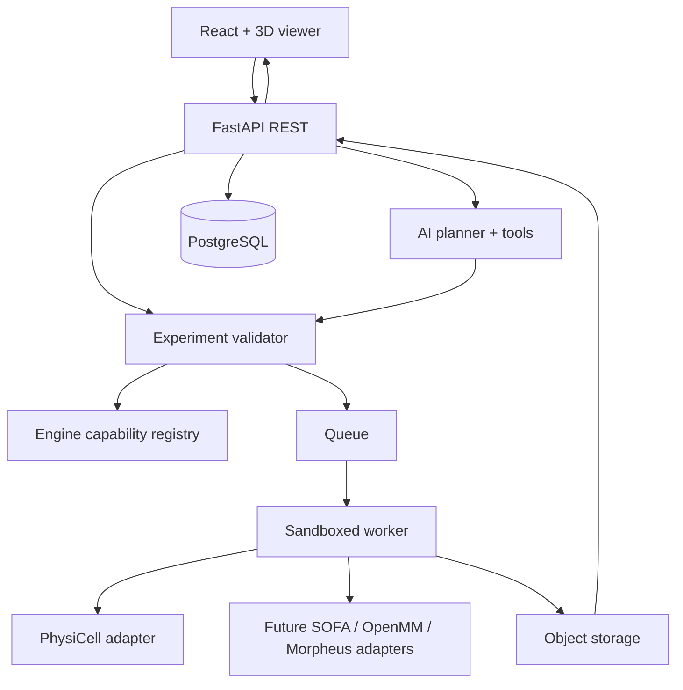

# Architecture

## Runtime boundaries

## Invariants
- POST plans only validated typed specs; AI cannot directly dispatch external binaries.
- All numerical outputs reference run id, engine id/version, model id/version, immutable spec hash, seed, environment and artifact digest.
- Units are compulsory on dimensional quantities (recommended Pint/UCUM compatible encoding).
- Adapter manifests declare geometry dimensionality, observables, limits and solver fidelity.
- Job state machine: draft -> validated -> queued -> running -> completed / failed / cancelled.
- API rejects impossible engine requests; unsupported fidelity creates a transparent capability gap.
- Idempotency keys prevent duplicate expensive runs.
- User prompt and simulation parameters are treated as untrusted input; no remote code execution.
- Artifacts are immutable, versioned and content-addressed where practical.
- Streaming is from real run status/artifacts, never fabricated frames.

## ExperimentSpec v1
- schema_version, intent, biological_system, entities, geometry, interactions, initial_conditions, parameters, output_requests, solver, seed, resources, assumptions.
- Validation in JSON Schema + Pydantic; migration/versioning specified before production.
- One canonical type source; TypeScript types generated from JSON Schema/OpenAPI.

## Scale separation
Cell-level models (PhysiCell) and atomistic models (OpenMM) do not share physics semantics. Never silently substitute engines. Cross-scale coupling requires explicit time/space mappings and separate validation.

## Observability
Trace prompt -> plan -> validated spec -> job -> adapter -> raw file -> analyzed metric. Correlate IDs, redact confidential prompts, record unit/solver validation errors.
